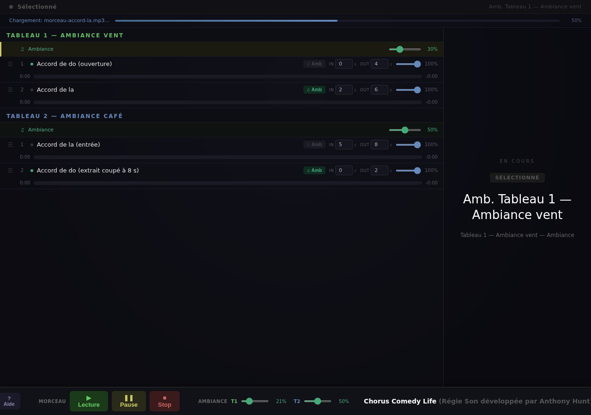

[English](README.md) · **Français**

# Chorus Comedy Life

**La régie son web d'un spectacle : une opératrice ou un opérateur, un écran, une liste de morceaux et d'ambiances, et aucun droit à l'erreur.**

Un spectacle ne s'arrête pas pour déboguer. Il faut lancer le morceau suivant au signal du metteur en scène, le baisser sous un dialogue, garder une ambiance qui tourne sous toute une scène, et ne jamais jouer le mauvais fichier. Cette page se pilote depuis un ordinateur portable au fond de la salle.



## Ce que fait la régie
- **Liste de morceaux par tableau**, numérotés, réordonnables, un clic pour lancer.
- **Fondus par morceau** : entrée et sortie réglées en secondes, individuellement.
- **Une ambiance par tableau**, avec son curseur de volume, mélangée sous les morceaux et laissée en boucle pendant toute la scène.
- **Transport qui se comporte** : lecture, pause, arrêt, morceau en cours toujours visible.
- **Tout est préchargé** : le compteur indique le nombre de fichiers en cache ; rien n'est téléchargé en plein spectacle.

## Décisions de conception
- **Les coupes se font au mastering, pas à la lecture.** Le lecteur ne sait pas couper un morceau au milieu : coupes, fondus et enchaînés sont cuits dans le fichier (`outils/masteriser.sh`). Ce que l'on entend en répétition est exactement ce qui jouera le soir.
- **Un seul niveau sonore** : chaque fichier est masterisé à −14 LUFS, 256 kb/s, 44,1 kHz. Sans cible fixe, des morceaux venus de dix sources arrivent à dix niveaux différents.
- **Deux environnements identiques** pour ne pas casser l'outil un jour de répétition : lancez une seconde instance sur un autre port avec un bandeau rouge (`--banner "TEST"`), validez les nouveautés, puis promouvez.
- **Les déplacements dans un morceau demandent des requêtes Range** : le serveur les gère.

## Installer et lancer
Prérequis : Python 3.8 ou plus ; ffmpeg pour le mastering (facultatif). Aucune autre dépendance.
```
git clone <ce dépôt> && cd chorus-comedy-life
python3 server.py                  # http://127.0.0.1:8080
python3 server.py --port 8081 --banner "TEST"      # instance de test avec bandeau rouge
```
Ouvrir l'adresse dans Chrome ou Firefox. Le dépôt contient une liste d'exemple (`cues.json`) et des sons synthétiques libres (`sons/`).

## Mettre vos morceaux
1. Masteriser : `outils/masteriser.sh mon-morceau.wav sons/mon-morceau.mp3 --debut 5 --fin 140 --fondu-sortie 6`
2. Décrire la liste dans `cues.json` : par tableau, `name`, `ambiance` (fichier), `ambVolume` (0 à 100) et `songs`. Chaque morceau : `name`, `file`, et facultativement `fadeIn`, `fadeOut` (secondes, 8 par défaut), `ambUnder` (ambiance en sourdine pendant le morceau), `endAt` (arrêt à telle seconde), `ambDuringIntro`, `noAmbAfter`.
3. Les fichiers audio sont cherchés dans `sons/` (ou `--audio DOSSIER`, ou `CUE_AUDIO`). **Les morceaux du commerce sont des œuvres protégées : ne les publiez pas dans un dépôt.**

## Contenu
`cue-player.html` (la régie), `server.py` (serveur), `cues.json` (liste d'exemple), `sons/` (5 sons synthétiques), `outils/masteriser.sh`.

## Licences
Code : Apache 2.0 (`LICENSE`, `NOTICE`). Textes, documentation et sons d'exemple : CC BY 4.0 (`LICENSE-docs`). Aucune dépendance.

Auteur : Anthony Hunt.
