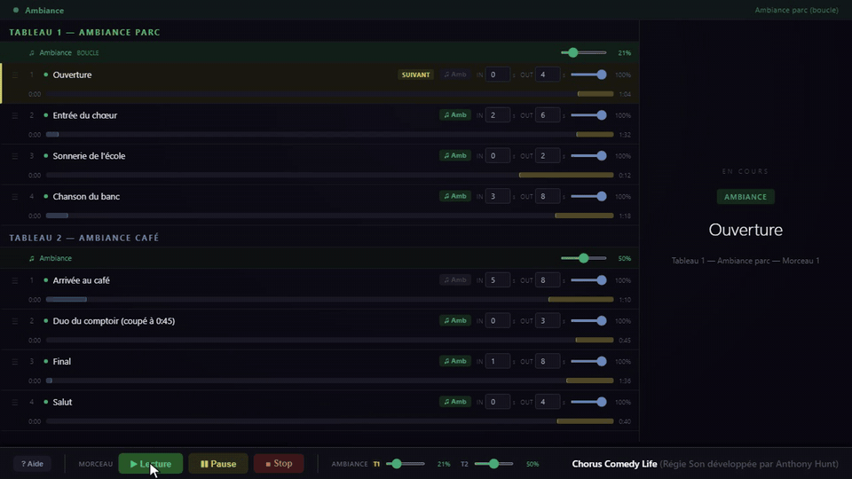

[English](README.md) · **Français**

# Chorus Comedy Life

**La régie son d'un spectacle, dans une page web : chaque morceau avec ses fondus, chaque tableau avec son ambiance.**

[](https://drive.google.com/file/d/1MWjlYt6Ng0mRCqeQCAyLu0-0qvqBfsSd/view)

*La vraie régie avec une liste de démonstration faite pour la vidéo ; sons synthétiques, vidéo muette. [Vidéo complète (1:12)](https://drive.google.com/file/d/1MWjlYt6Ng0mRCqeQCAyLu0-0qvqBfsSd/view)*

## Ce qu'on fait avec

- **Tableaux.** Une liste numérotée par tableau : cliquer un morceau, puis Lecture.
- **Ambiance.** Une boucle par tableau, avec son volume. Elle s'efface quand un morceau démarre et revient pendant son fondu de sortie.
- **Fondus.** Fondu d'entrée et de sortie en secondes pour chaque morceau, en bleu et en jaune sur sa barre de progression. Un morceau peut aussi s'arrêter à une seconde donnée.
- **Lecture.** Lecture, pause, arrêt ; un clic sur la barre de progression déplace dans le morceau en cours.
- **Préparation des fichiers.** `outils/masteriser.sh` coupe chaque fichier et l'amène au même volume (−14 LUFS, 256 kb/s, 44,1 kHz) : les coupes sont dans le fichier, jamais faites en direct.

## Architecture


<details><summary>Diagramme en français</summary>


</details>

## Déploiement

- **Usage.** Répétitions d'une comédie musicale, à partir de mai 2026 : trois tableaux, chacun avec son ambiance.
- **Hébergement.** Service Python derrière HTTPS sur un serveur personnel, avec une instance de test à bandeau rouge où les changements étaient vérifiés avant la mise en ligne. Retiré le 5 novembre 2026 et archivé.
- **Ce dépôt.** La même régie avec une liste d'exemple (`cues.json`) et quatre sons synthétiques (`sons/`). Python 3.8 ou plus, aucune dépendance ; ffmpeg seulement pour la préparation des fichiers.
- **Limites.** La poignée ☰ ne réordonne pas les morceaux. Le bouton Amb est sans effet : l'ambiance s'arrête toujours sous un morceau. Les curseurs du pied de page partent de 21 % et 50 % quel que soit `cues.json`, et ne couvrent que deux tableaux. Les fichiers sont téléchargés à l'ouverture de la page, mais la lecture les redemande au serveur.

## Lancer

```
python3 server.py
outils/masteriser.sh in.wav sons/out.mp3
```

La régie s'ouvre sur http://127.0.0.1:8080. `masteriser.sh` accepte `--debut`, `--fin`, `--fondu-entree`, `--fondu-sortie` en secondes. `cues.json` contient `tableaux`, chacun avec `name`, `ambiance`, `ambVolume` et `songs` ; chaque morceau a `name` et `file`, et au besoin `fadeIn`, `fadeOut`, `endAt`, `noAmbAfter`. Les morceaux du commerce sont des œuvres protégées : les garder hors du dépôt.

---

**Anthony Hunt** · [ingevision.cloud](https://ingevision.cloud/?p=chorus-comedy-life) · [LinkedIn](https://www.linkedin.com/in/anthony-hunt-3948a9196) · [GitHub](https://github.com/anthohunt)

Code : Apache 2.0. Textes et sons d'exemple : CC BY 4.0.
