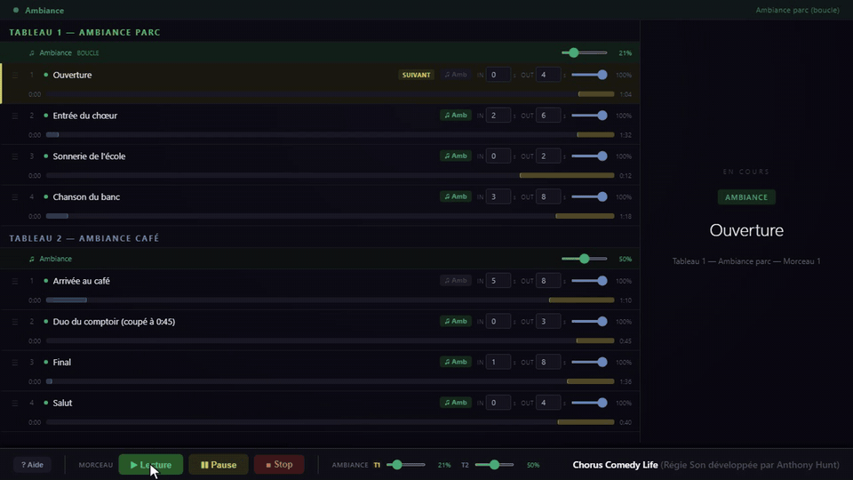

**English** · [Français](README.fr.md)

# Chorus Comedy Life

**The sound desk of a live show, in one web page.** Each song starts on a click with its own fades, the scene's ambience loops underneath, and every file is loaded before the show starts.

[](https://drive.google.com/file/d/1MWjlYt6Ng0mRCqeQCAyLu0-0qvqBfsSd/view)

*The real desk with a demo list and synthetic sounds; the video has no sound. [Full video (1:12)](https://drive.google.com/file/d/1MWjlYt6Ng0mRCqeQCAyLu0-0qvqBfsSd/view)*

## Using it

- **Scenes.** One numbered list per scene: click a song, then Play.
- **Ambience.** One loop per scene, with its volume. Under a song it drops to 15 % or stops, depending on the song's Amb button.
- **Fades.** Fade-in and fade-out in seconds for each song, shown in blue and yellow on its progress bar. A song can stop at a set second.
- **Transport.** Play, pause, stop. Clicking the bar jumps within the song; the right panel shows the current song in large type.
- **Preloaded.** Every file is cached when the page opens; a green dot marks each ready song.
- **Mastering.** `outils/masteriser.sh` bakes cuts and fades into the file at −14 LUFS, 256 kb/s, 44.1 kHz: what plays in rehearsal is what plays on the night.

## Architecture


*Diagram labels are in French.*

## Deployment

- **Use.** Rehearsals of a musical, from May 2026: three scenes, each with its own ambience.
- **Hosting.** Python service behind HTTPS on a personal server, plus a test instance with a red banner where changes were checked before going live. Taken offline on 5 November 2026 and archived.
- **This repository.** The same desk with a sample list (`cues.json`) and four synthetic sounds (`sons/`). Python 3.8 or later, no dependency; ffmpeg only for mastering.
- **Not working yet.** Reordering songs with the ☰ handle; the footer volume sliders cover the first two scenes only.

## Run it

```
python3 server.py                               # http://127.0.0.1:8080
python3 server.py --port 8081 --banner "TEST"   # test instance with a red banner
outils/masteriser.sh song.wav sons/song.mp3 --debut 5 --fin 140 --fondu-sortie 6
```

Describe your scenes in `cues.json` (`name`, `ambiance`, `ambVolume`, `songs`; per song `fadeIn`, `fadeOut`, `ambUnder`, `endAt`). Commercial songs are protected works: keep them out of the repository. The interface is in French.

---

**Anthony Hunt** · [ingevision.cloud](https://ingevision.cloud/?lang=en&p=chorus-comedy-life) · [LinkedIn](https://www.linkedin.com/in/anthony-hunt-3948a9196) · [GitHub](https://github.com/anthohunt)

Code: Apache 2.0. Text and sample sounds: CC BY 4.0.
