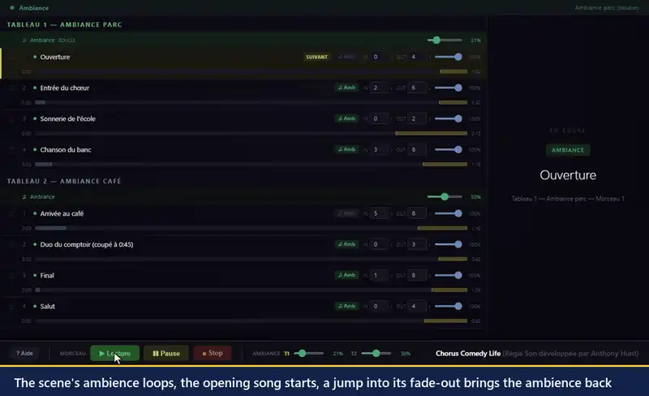
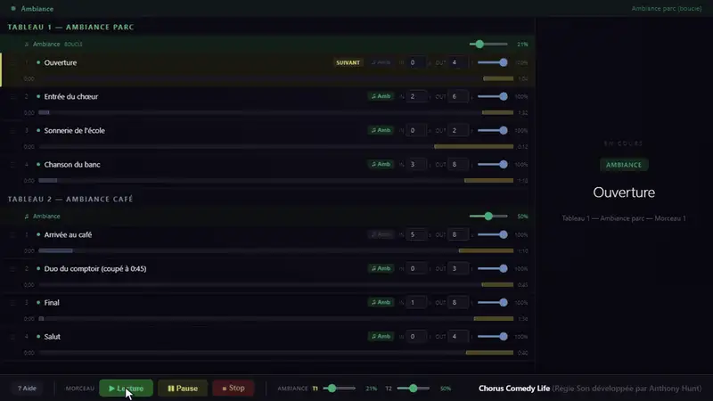

**English** · [Français](README.fr.md)

# Chorus Comedy Life

**The sound desk of a live show, in one web page: each song with its own fades, each scene with its own ambience.**



<details><summary>French version</summary>



</details>

*The real desk with a demo list made for the video; synthetic sounds, silent video.*

## Using it

- **Scenes.** One numbered list per scene: click a song, then Play.
- **Ambience.** One loop per scene, with its volume. It fades out when a song starts and comes back during the song's fade-out.
- **Fades.** Fade-in and fade-out in seconds for each song, shown in blue and yellow on its progress bar. A song can also stop at a set second.
- **Playback.** Play, pause, stop; clicking the progress bar jumps within the playing song.
- **File preparation.** `outils/masteriser.sh` cuts each file and brings it to the same loudness (−14 LUFS, 256 kb/s, 44.1 kHz), so cuts are made in the file, never live.

## Architecture


<details><summary>French version</summary>


</details>

## Deployment

- **Use.** Rehearsals of a musical, from May 2026: three scenes, each with its own ambience.
- **Hosting.** Python service behind HTTPS on a personal server, plus a test instance with a red banner where changes were checked before going live. Taken offline on 5 November 2026 and archived.
- **This repository.** The same desk with a sample list (`cues.json`) and four synthetic sounds (`sons/`). Python 3.8 or later, no dependency; ffmpeg only for file preparation.
- **Limits.** The ☰ handle does not reorder songs. The Amb button has no effect: the ambience always stops under a song. The footer sliders start at 21 % and 50 % whatever `cues.json` says, and cover two scenes only. Files are downloaded when the page opens, but playback still streams them from the server.

## Run it

```
python3 server.py
outils/masteriser.sh in.wav sons/out.mp3
```

The desk opens at http://127.0.0.1:8080. `masteriser.sh` takes `--debut`, `--fin`, `--fondu-entree`, `--fondu-sortie` in seconds. `cues.json` holds `tableaux`, each with `name`, `ambiance`, `ambVolume` and `songs`; each song has `name` and `file`, optionally `fadeIn`, `fadeOut`, `endAt`, `noAmbAfter`. Commercial songs are protected works: keep them out of the repository.

---

**Anthony Hunt** · [ingevision.cloud](https://ingevision.cloud/?lang=en&p=chorus-comedy-life) · [LinkedIn](https://www.linkedin.com/in/anthony-hunt-3948a9196) · [GitHub](https://github.com/anthohunt)

Code: Apache 2.0. Text and sample sounds: CC BY 4.0.
