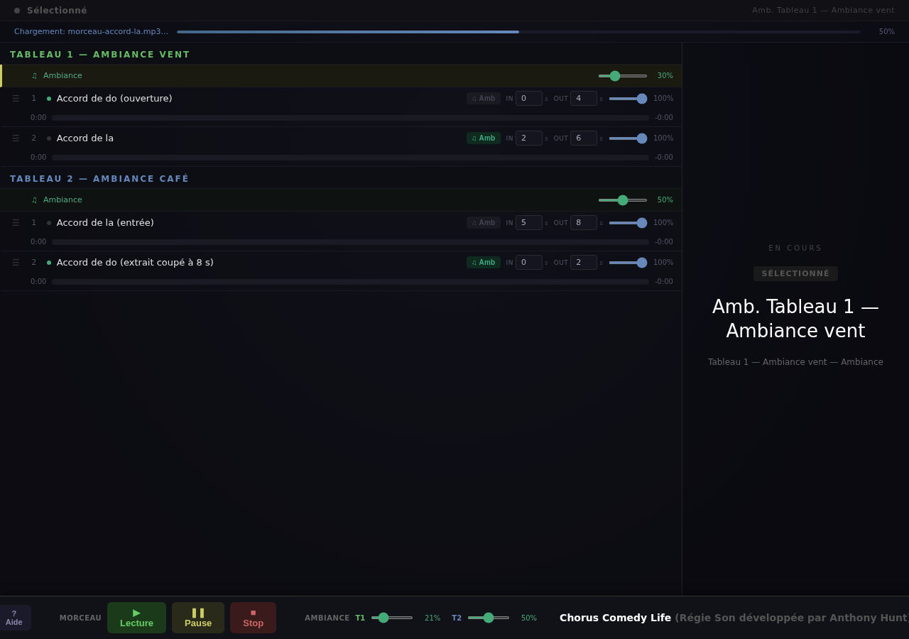

**English** · [Français](README.fr.md)

**Anthony Hunt** · [Project page on ingevision.cloud](https://ingevision.cloud/?lang=en&p=chorus-comedy-life) · [LinkedIn](https://www.linkedin.com/in/anthony-hunt-3948a9196) · [GitHub profile](https://github.com/anthohunt)

# Chorus Comedy Life

**The web sound desk of a live show: one operator, one screen, a list of songs and ambiences, and no room for error.**

A show does not stop for debugging. You have to start the next song on the director's cue, bring it down under a line of dialogue, keep an ambience running under a whole scene, and never play the wrong file. This page is driven from a laptop at the back of the room.



The interface is in French.

## What the desk does
- **Song list per scene**, numbered, reorderable, one click to start.
- **Per-song fades**: fade-in and fade-out set in seconds, individually.
- **One ambience per scene**, with its volume slider, mixed under the songs and left looping for the whole scene.
- **Transport that behaves**: play, pause, stop, current song always visible.
- **Everything is preloaded**: the counter shows how many files are cached; nothing is downloaded during the show.

## Design decisions
- **Cuts happen at mastering, not at playback.** The player cannot cut a song in the middle: cuts, fades and crossfades are baked into the file (`outils/masteriser.sh`). What you hear in rehearsal is exactly what plays on the night.
- **One loudness level**: every file is mastered to −14 LUFS, 256 kb/s, 44.1 kHz. Without a fixed target, songs from ten sources arrive at ten different levels.
- **Two identical environments** so the tool does not break on a rehearsal day: start a second instance on another port with a red banner (`--banner "TEST"`), validate the changes, then promote them.
- **Seeking within a song requires Range requests**: the server handles them.

## Install and run
Requirements: Python 3.8 or later; ffmpeg for mastering (optional). No other dependency.
```
git clone <this repository> && cd chorus-comedy-life
python3 server.py                  # http://127.0.0.1:8080
python3 server.py --port 8081 --banner "TEST"      # test instance with a red banner
```
Open the address in Chrome or Firefox. The repository contains a sample list (`cues.json`) and free synthetic sounds (`sons/`).

## Adding your songs
1. Master: `outils/masteriser.sh my-song.wav sons/my-song.mp3 --debut 5 --fin 140 --fondu-sortie 6` (start, end, fade-out, in seconds)
2. Describe the list in `cues.json`: per scene, `name`, `ambiance` (file), `ambVolume` (0 to 100) and `songs`. Each song: `name`, `file`, and optionally `fadeIn`, `fadeOut` (seconds, 8 by default), `ambUnder` (ambience ducked during the song), `endAt` (stop at a given second), `ambDuringIntro`, `noAmbAfter`.
3. Audio files are looked up in `sons/` (or `--audio FOLDER`, or `CUE_AUDIO`). **Commercial songs are protected works: do not publish them in a repository.**

## Contents
`cue-player.html` (the desk), `server.py` (server), `cues.json` (sample list), `sons/` (5 synthetic sounds), `outils/masteriser.sh`.

## Licenses
Code: Apache 2.0 (`LICENSE`, `NOTICE`). Text, documentation and sample sounds: CC BY 4.0 (`LICENSE-docs`). No dependencies.

Author: Anthony Hunt.
